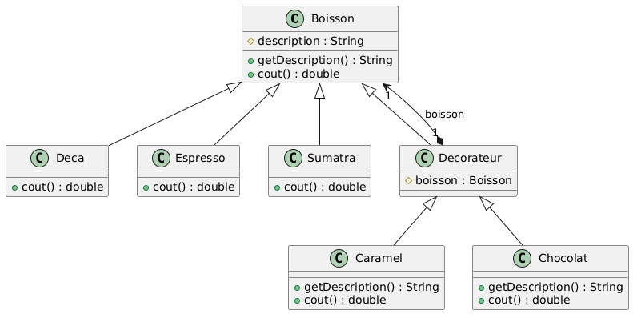
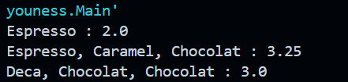

# Rapport de Travaux Pratiques : Design Pattern Decorator

**Encadrant :** Mohamed YOUSSFI  
**Étudiant :** HATTABI Youness

---

## Table des Matières

1. [Introduction](#1-introduction)
2. [Présentation du pattern](#2-présentation-du-pattern)
   - 2.1 [Problème posé](#21-problème-posé)
   - 2.2 [Solution proposée](#22-solution-proposée)
   - 2.3 [Acteurs du pattern](#23-acteurs-du-pattern)
3. [Diagramme de classes](#3-diagramme-de-classes)
4. [Implémentation](#4-implémentation)
   - 4.1 [La classe abstraite `Boisson`](#41-la-classe-abstraite-boisson)
   - 4.2 [Les boissons concrètes](#42-les-boissons-concrètes)
   - 4.3 [La classe abstraite `Decorateur`](#43-la-classe-abstraite-decorateur)
   - 4.4 [Les décorateurs concrets](#44-les-décorateurs-concrets)
5. [Tests et Résultats](#5-tests-et-résultats)
6. [Conclusion](#6-conclusion)

---

## 1. Introduction

Le pattern **Decorator** est un pattern de conception _structurel_. Il permet d'ajouter dynamiquement des responsabilités à un objet, sans modifier sa classe et sans passer par une explosion de sous-classes.

Ce rapport illustre le pattern à travers un cas classique : une boutique de boissons chaudes (`Deca`, `Espresso`, `Sumatra`) à laquelle on peut ajouter des suppléments (`Caramel`, `Chocolat`) qui modifient la description et le prix.

---

## 2. Présentation du pattern

### 2.1 Problème posé

Si l'on voulait représenter toutes les combinaisons possibles (Espresso + Caramel, Espresso + Chocolat + Caramel, Deca + Chocolat + Chocolat, etc.) avec de l'héritage seul, il faudrait créer une classe par combinaison. Le nombre de classes croîtrait de manière exponentielle à chaque nouveau supplément.

### 2.2 Solution proposée

Le décorateur est **à la fois** une `Boisson` (il hérite de la classe de base) **et** il possède une `Boisson` (il contient la boisson qu'il enveloppe). Cette double relation permet d'empiler les décorateurs comme des poupées russes : chaque décorateur délègue à la boisson enveloppée, puis ajoute son propre comportement.

### 2.3 Acteurs du pattern

| Rôle                 | Classe                        | Responsabilité                                     |
| -------------------- | ----------------------------- | -------------------------------------------------- |
| Composant            | `Boisson`                     | Définit `getDescription()` et `cout()`             |
| Composants concrets  | `Deca`, `Espresso`, `Sumatra` | Boissons de base avec leur propre prix             |
| Décorateur           | `Decorateur`                  | Hérite de `Boisson` et contient une `Boisson`      |
| Décorateurs concrets | `Caramel`, `Chocolat`         | Ajoutent un supplément à la description et au coût |

---

## 3. Diagramme de classes

**Diagramme UML généré depuis IntelliJ IDEA :**



Lecture du diagramme :

- `Deca`, `Espresso`, `Sumatra` et `Decorateur` **héritent** de `Boisson`.
- `Decorateur` **contient** une `Boisson` (association avec losange, attribut `boisson`).
- `Caramel` et `Chocolat` **héritent** de `Decorateur`.

**Organisation du projet :**

```
src/main/java/
├── deco/
│   ├── Boisson.java
│   ├── Deca.java
│   ├── Espresso.java
│   ├── Sumatra.java
│   ├── Decorateur.java
│   ├── Caramel.java
│   └── Chocolat.java
└── hattabi/youness/Main.java
```

---

## 4. Implémentation

### 4.1 La classe abstraite `Boisson`

Elle déclare l'attribut protégé `description` et les deux méthodes du contrat. Le coût est abstrait, car chaque boisson a son propre prix.

```java
package deco;

public abstract class Boisson {
    protected String description = "Boisson inconnue";

    public String getDescription() {
        return description;
    }

    public abstract double cout();
}
```

---

### 4.2 Les boissons concrètes

Chaque boisson initialise sa description et fournit son prix.

```java
package deco;

public class Deca extends Boisson {
    public Deca() {
        description = "Deca";
    }

    @Override
    public double cout() {
        return 1.5;
    }
}
```

```java
package deco;

public class Espresso extends Boisson {
    public Espresso() {
        description = "Espresso";
    }

    @Override
    public double cout() {
        return 2.0;
    }
}
```

```java
package deco;

public class Sumatra extends Boisson {
    public Sumatra() {
        description = "Sumatra";
    }

    @Override
    public double cout() {
        return 2.5;
    }
}
```

---

### 4.3 La classe abstraite `Decorateur`

Cette classe porte les deux relations clés du pattern : elle **est** une `Boisson` (héritage) et **a** une `Boisson` (attribut `boisson`). Elle reste abstraite car elle n'implémente pas `cout()`.

```java
package deco;

public abstract class Decorateur extends Boisson {
    protected Boisson boisson;
}
```

---

### 4.4 Les décorateurs concrets

Chaque décorateur reçoit la boisson à envelopper dans son constructeur, puis redéfinit `getDescription()` et `cout()` en déléguant à la boisson enveloppée.

```java
package deco;

public class Caramel extends Decorateur {
    public Caramel(Boisson boisson) {
        this.boisson = boisson;
    }

    @Override
    public String getDescription() {
        return boisson.getDescription() + ", Caramel";
    }

    @Override
    public double cout() {
        return boisson.cout() + 0.5;
    }
}
```

```java
package deco;

public class Chocolat extends Decorateur {
    public Chocolat(Boisson boisson) {
        this.boisson = boisson;
    }

    @Override
    public String getDescription() {
        return boisson.getDescription() + ", Chocolat";
    }

    @Override
    public double cout() {
        return boisson.cout() + 0.75;
    }
}
```

---

## 5. Tests et Résultats

```java
package hattabi.youness;

import deco.*;

public class Main {
    public static void main(String[] args) {
        Boisson b1 = new Espresso();
        System.out.println(b1.getDescription() + " : " + b1.cout());

        Boisson b2 = new Espresso();
        b2 = new Caramel(b2);
        b2 = new Chocolat(b2);
        System.out.println(b2.getDescription() + " : " + b2.cout());

        Boisson b3 = new Chocolat(new Chocolat(new Deca()));
        System.out.println(b3.getDescription() + " : " + b3.cout());
    }
}
```

**Sortie attendue :**

```
Espresso : 2.0
Espresso, Caramel, Chocolat : 3.25
Deca, Chocolat, Chocolat : 3.0
```

**Capture de l'exécution :**



**Déroulement de l'appel `b2.cout()` :**

```
Chocolat.cout()
 └─ boisson.cout()  → Caramel.cout()
     └─ boisson.cout()  → Espresso.cout() = 2.0
     + 0.5 = 2.5
 + 0.75 = 3.25
```

Le troisième test montre la force du pattern : un double chocolat ne nécessite aucune nouvelle classe, il suffit d'envelopper deux fois.

---

## 6. Conclusion

Ce travail a permis de mettre en œuvre le pattern Decorator. La double relation héritage et composition entre `Decorateur` et `Boisson` permet de composer librement des comportements, ce qui offre une alternative flexible à l'héritage.
